<p align="center">
  
</p>

<h1 align="center">Волей Метрика</h1>

<p align="center">
  <b>Статистика волейбольного матча: разбор по видео на 3D-площадке, ввод кнопками и пульт на телефоне.</b><br>
  Для тренеров и статистиков любительских команд. Всё работает на своём ноутбуке и без интернета.
</p>

<p align="center">
  
  
  
  
  
</p>

<p align="center">
  <a href="#start">Быстрый старт</a> ·
  <a href="#modes">Три режима</a> ·
  <a href="#tour">Тур по программе</a> ·
  <a href="#remote">Пульт и сеть</a> ·
  <a href="#keys">Клавиши</a> ·
  <a href="#transfer">Перенос данных</a> ·
  <a href="#faq">Проблемы</a>
</p>

<p align="center">
  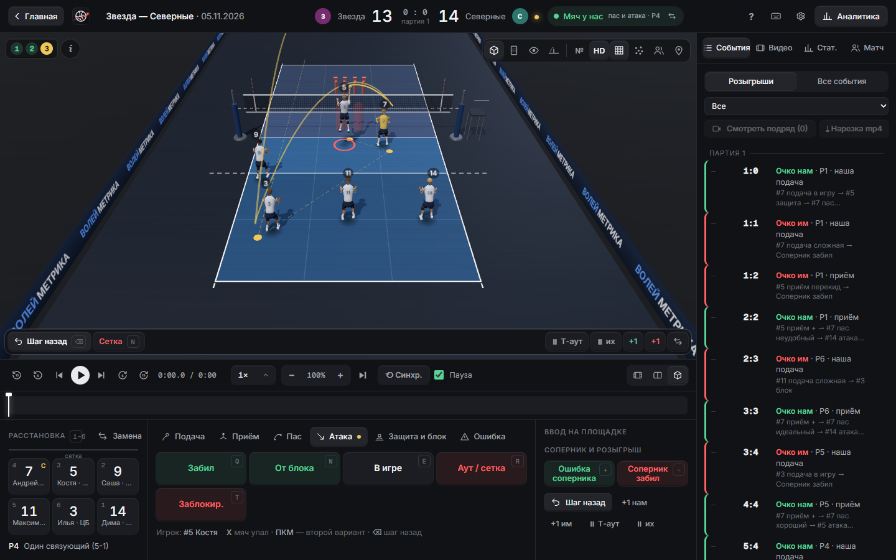
</p>

---

## ✨ Что умеет

| | |
|---|---|
| 🎬 **Разбор по видео** | Любой формат файла, зум до 8×, покадровый шаг. Касания привязываются к кадрам, а повтор на 3D идёт синхронно с видео |
| 🏐 **3D-площадка** | Розыгрыш вводится кликами так же, как летит мяч: приём → доводка → пас → атака. Игроки сами бегут, пасуют, бьют и блокируют |
| ⌨️ **Ввод кнопками** | Каждое касание без 3D и без видео, когда нужно быстро собрать подробную статистику |
| 📱 **Пульт на телефоне** | QR-код — и телефон в той же сети записывает, кто закончил розыгрыш и чем. Нажатия не теряются, даже если пропала связь |
| 📊 **Аналитика** | Сайд-аут и брейк, ход партии, тепловые карты, отчёт связующего, расстановки, игроки, соперник, прогресс по турнирам |
| 🧩 **Расстановки** | Р1–Р6 для приёма, подачи и защиты, пресеты 5-1, 4-2, 6-2 и гибрид, проверка правил расстановки |
| ✂️ **Нарезка лучших моментов** | Отмечаешь розыгрыши звёздочкой, программа склеивает их в один mp4 |
| 📄 **Отчёт игрока** | Очки, атака, приём, карты и лучшие моменты на одной странице. Сохраняется в PDF |
| 🧳 **Переносится одним файлом** | Пакет команды, отдельный матч или все данные сразу. Резервная копия делается сама раз в день |
| 🔌 **Без интернета** | Интернет нужен один раз, при первом запуске. Потом всё работает локально, в том числе на турнире без Wi-Fi |

---

<a id="start"></a>

## 🚀 Быстрый старт

1. Установи **[Node.js](https://nodejs.org/) версии LTS**: скачай установщик и нажимай «Next». Подойдёт Node.js 20.15+ или 22.2+.
2. Получи программу: **Code → Download ZIP** на странице репозитория и распакуй в обычную папку.
   Репозиторий приватный, поэтому нужен доступ. Без него архив может прислать владелец.
3. Дважды кликни **`start.bat`**. При первом запуске он сам поставит зависимости, это занимает пару минут.
4. Браузер откроет `http://localhost:4200`. Если этого не случилось, открой адрес вручную.
5. Заполни команду: **Команда → Состав, форма, расстановки**. Или загрузи готовый [пакет команды](#transfer).
6. Нажми **Новый матч**, выбери соперника и формат, затем **▶ Начать** в нужном режиме.

> [!TIP]
> Первый запуск делай дома с интернетом: `start.bat` скачает зависимости и встроенный FFmpeg для видео.
> Дальше интернет не нужен.

> [!IMPORTANT]
> Чёрное окно с сервером не закрывай, пока работаешь: без него программа остановится.
> Браузер — **Chrome или Edge**. Windows при первом запуске спросит про брандмауэр: разреши доступ, иначе не подключится телефон.

Хочешь посмотреть программу без настоящей игры? Запусти **`demo.bat`**: откроется студия с демо-командой и готовыми матчами.
Демо живёт в отдельной папке `demo-data/` и настоящие данные не трогает. Перед запуском закрой окно `start.bat`: порт один на двоих.

---

<a id="storage"></a>

## 🗂 Где что хранится

Программа состоит из двух независимых частей:

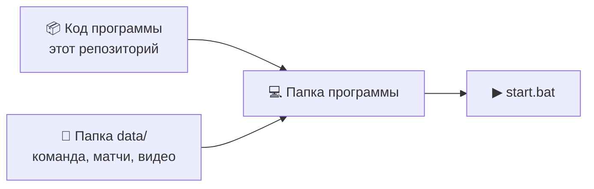

**Код** одинаков у всех. **Данные** лежат в папке `data/` рядом со `start.bat`, она появляется при первом запуске.
В git эта папка не попадает: так прописано в `.gitignore`. Поэтому архив с GitHub приходит **без твоих данных**, а новая версия программы их не трогает.

| Что | Где |
|---|---|
| состав команды | `data/roster.json` |
| название, эмблемы, форма, соперники, турниры, пресеты расстановок, зоны доводки | `data/settings.json` |
| матчи, по файлу на матч | `data/match-*.json` |
| видео и их список | `data/videos/` |
| готовые нарезки | `data/clips/` |
| автоматические резервные копии | `data/backups/` |
| удалённые матчи | `data/trash/` |

<details>
<summary><b>Что хранится в браузере и не переезжает</b></summary>

<br>

Эти настройки привязаны к конкретному компьютеру, поэтому живут в браузере, а не в `data/`:

- настройки разделов «Плеер», «3D-площадка» и режим подсказок;
- пройденное обучение в студии;
- какой экран откроет кнопка «Продолжить»;
- свёрнутое боковое меню.

Папка `node_modules/` тоже не переносится: `start.bat` поставит её сам.
</details>

---

<a id="modes"></a>

## 🎚 Три режима статистики

Главная сущность программы — **матч с партиями**. Внутри матча есть три независимых вида статистики:

| Режим | Что собирает | Где вводится | Когда нужен |
|---|---|---|---|
| **Студия PRO** | каждое касание с точками на 3D и привязкой к видео | компьютер | подробный разбор после игры |
| **Ручной PRO** | каждое касание кнопками, без 3D | компьютер | подробная статистика без видео |
| **Экспресс stat** | кто закончил розыгрыш и чем | телефон или компьютер | вживую на турнире |

> [!NOTE]
> Режимы **не суммируются**. Если ты вёл Экспресс на турнире, а потом разобрал ту же игру в Студии, это две разные статистики одного матча.
> Студия начинается с чистого листа и данные пульта не подтягивает. В каждом режиме партии идут строго по порядку: вторую нельзя начать, пока не закончена первая.

---

<a id="tour"></a>

## 🧭 Тур по программе

### 🏠 Главная и карточка матча

<p align="center">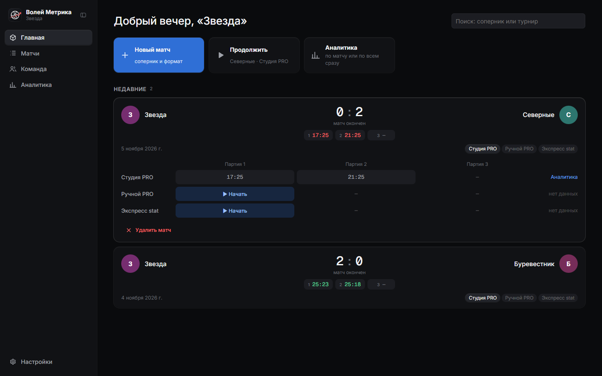</p>

Слева боковое меню: **Главная, Матчи, Команда, Аналитика, Настройки**. Кнопка рядом с логотипом сворачивает его, а свёрнутое меню выезжает, когда мышь подходит к левому краю.

- **Новый матч** — окно поверх главной: формат и соперник. Новый соперник создаётся здесь же.
- **Продолжить** — последний экран ввода.
- **Поиск** — по сопернику или турниру.

Нажми на карточку матча, и под ней раскроется таблица «режим × партия»:

| В ячейке | Что значит | Что будет при нажатии |
|---|---|---|
| счёт `25:18` | партия сыграна | аналитика этой партии |
| счёт и «идёт» | партия не закончена | продолжить ввод |
| **▶ Начать** | следующая партия по порядку | открыть экран ввода |
| `—` | партия пока недоступна | ничего, партии идут по порядку |

Режим без данных показан серым. Удалённый матч уходит в корзину, вернуть его можно в **Настройки → Данные**.

#### Формат матча

Формат выбирается при создании матча, а поменять его можно во вкладке «Матч» в студии:

- **до 2 побед** — партии до 25, решающая третья до 15 (по умолчанию);
- **до 3 побед** — четыре партии до 25, решающая пятая до 15;
- **одна партия до 25** или **до 15** — одиночные матчи, с одним соперником их может быть сколько угодно;
- **своя настройка** — сколько партий выиграть, до скольки очков партия и решающая.

Везде нужна разница в 2 очка, а после нужного числа побед матч заканчивается сам. Последний выбранный формат запоминается.

---

### 🎬 Студия PRO

Открывается из карточки матча. Устроена как монтажная программа:

- **сверху** — видео и 3D-площадка, разделитель тянется мышью, а кнопки справа от транспорта оставляют только видео, обе панели или только площадку;
- **посередине** — транспорт и **таймлайн с метками**: зелёные — очко нам, красные — им, жёлтые — тайм-ауты;
- **снизу** — расстановка и кнопки действий, это запасной способ ввода без площадки;
- **справа** — панели «События», «Видео», «Стат.» и «Матч».

При первом открытии запускается короткий тур из 11 шагов. Пройти его снова можно через кнопку ⌨ или **Настройки → Общие**.
Вернуться на главную — кнопка **«Главная»** или <kbd>Ctrl</kbd>+<kbd>O</kbd>.

#### Видео

Перетащи файл матча в любое место окна. Он **копируется** в `data/videos`, поэтому исходник потом можно удалить.

Формат не важен, встроенный **FFmpeg** разберётся сам. H.264 в mp4 открывается сразу. mkv, mov и avi с обычным кодеком переупаковываются за секунды.
H.265/HEVC (iPhone, экшн-камеры), 10-бит, ProRes и прочее перекодируются в H.264: прогресс виден в панели «Видео», а работать в это время можно.

- **Зум:** колесо мыши над видео (до 8×), перетаскивание — сдвиг, двойной клик — сброс. При зуме в углу появляется мини-карта кадра.
- **Перемотка:** кнопки ±5 и ±15 секунд и покадрово. Скорость меняется от 0,1× до 2×.
- **Несколько файлов:** если матч снят по частям, привяжи все файлы к матчу. Каждое событие запоминает свою секунду и своё видео.
- **Клик по метке** или по строке в «Событиях» перематывает видео к моменту, за 2 секунды до него.
- **«Смотреть клипы»** подряд проигрывает все события по фильтру: например, «Пас» и «#7».
- **«Пауза при вводе»** останавливает видео, пока ты выбираешь игрока или кликаешь по площадке.
- **▶|** (<kbd>End</kbd>) возвращает 3D и видео к текущему шагу ввода.

#### Ввод розыгрыша на 3D-площадке

Розыгрыш вводится кликами, так же как идёт мяч. Слева сверху видно счётчик касаний **1 · 2 · 3** и подсказку, что кликнуть сейчас.

**Каждый шаг — это точка, потом игрок.** Кликаешь точку, и пульсирует игрок, который вероятнее всего сыграл мяч.
Шаг завершается кликом по игроку: по пульсирующему (или <kbd>Enter</kbd>) либо по другому. Клик сразу по игроку ставит точку и игрока одним действием.

| Шаг | Точка | Игрок |
|---|---|---|
| **Приём / защита** | куда пришёл мяч | кто принял (по умолчанию ближайший) |
| **Доводка** | куда мяч пришёл к пасующему. Оценка приёма считается **сама по зонам доводки** (++ / + / −) | кто пасует (по схеме) |
| **Пас** | откуда бьют: дуга тянется за мышью, **колесо — высота** (1/2/3 темп), <kbd>Q</kbd> <kbd>W</kbd> <kbd>E</kbd> — качество | кто бьёт |
| **Атака** | на их площадке: **один клик — мяч в игре**, **двойной — забили в эту точку**, за линиями — аут, ПКМ — меню, <kbd>N</kbd> — сетка, клик **по рукам блока** — блок-аут, в пол или отскок к нам | — |
| **Наша подача** | на их половине: ЛКМ — в игру, ПКМ — меню (сложная, эйс, ошибка), за линиями — аут | — |
| **Мяч у соперника** | веди мышь **по сетке** — появится наш блок, клик ставит его. Дальше: на их половине — откуда бьют, по нашей площадке — куда пришёл мяч, по **рукам** — результат блока. ПКМ — не подняли | кто защищал |

**Шаг назад** (<kbd>⌫</kbd>) работает пошагово: удалил пас — снова тянешь дугу от той же точки.

Игроки двигаются по ситуации: на приёме задняя линия глубже, в атаке нападающие на разбеге, в обороне двое блокируют, а задняя линия страхует. Тот, кто сыграл мяч, выбегает в точку касания.

#### Синхронизация с видео

Кнопка **«⟲ Синхр.»** под видео (или <kbd>L</kbd>) включает режим, в котором розыгрыш вводится вслед за видео:

1. Видео идёт на скорости 0,75×. В момент касания жмёшь **Пробел** — получается стоп-кадр.
2. Ставишь точку на 3D и подтверждаешь игрока. **Время касания — кадр стоп-кадра**, а не момент подтверждения.
3. Видео само продолжает с этого кадра. Если следующее касание не отмечено за 3, 5, 8 или 12 секунд, видео возвращается к последнему касанию и идёт вторым кругом на 0,5×. Пропустить момент нельзя.
4. Розыгрыш закончился, петля выключилась. <kbd>Tab</kbd> — быстро вперёд ×3 к следующей подаче, Пробел — стоп.
5. **Шаг назад** откатывает и видео.

Скорость и длина петли настраиваются в **Настройки → Плеер**.

#### Розыгрыши и лучшие моменты

Вкладка «События» → **«Розыгрыши»**: по строке на розыгрыш со счётом, расстановкой и цепочкой касаний. Клик по строке (или <kbd>PgUp</kbd> / <kbd>PgDn</kbd>) ставит видео на начало розыгрыша, а 3D показывает его же.
Когда видео идёт по размеченным розыгрышам, 3D **повторяет их синхронно**.

- ☆ отмечает лучший момент, ✎ добавляет заметку;
- фильтр сверху: все, избранное, наши очки, их очки;
- **«Смотреть подряд»** проигрывает отфильтрованные розыгрыши;
- **«Нарезка mp4»** склеивает их в один файл, по 2,5 секунды до и после. Готовые нарезки лежат во вкладке «Видео» и в `data/clips`.

#### Правка по видео

- Клик по событию открывает карточку: поменять игрока, результат, темп; «Время = сейчас» привязывает к текущему кадру; «Точки» — перекликать точки; «Удалить».
- **«Вставить перед»** включает режим вставки пропущенных касаний. Счёт, подача и расстановка показываются на тот момент.
- Счёт и статистика после любой правки пересчитываются сами.

#### Живая статистика и вкладка «Матч»

<p align="center">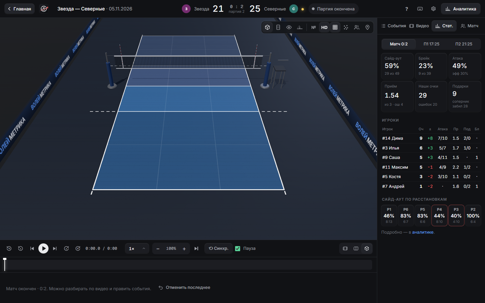</p>

**«Стат.»** обновляется с каждым касанием: сайд-аут, брейк, атака, приём, таблица игроков и сайд-аут по расстановкам. Во время серии соперника 3:0 и больше появляется подсказка про тайм-аут.

**«Матч»** — настройки открытого матча:

| Настройка | Что делает |
|---|---|
| **Турнир** | Привязка к турниру, ＋ создаёт новый. Новый турнир становится текущим: новые матчи попадают в него, пока не выберешь другой |
| **Формат, пресет, схема игры** | Для этого матча. Схема только подсказывает, кто пасует |
| **Роли в этом матче** | Если ЦБ вынужденно играет доигровщиком: меняется только этот матч, не команда |
| **Скаутинг соперника** | Под площадкой появляются чипы «Подаёт №» и «Бьёт №». Отчёт копится в разделе «Соперник» аналитики |
| **Отмечать каждый пас** | Для подробной статистики связующего |

**Тайм-ауты:** кнопки «Т-аут» и «их» под площадкой. Тайм-аут становится меткой на таймлайне, а в аналитике видно, выигран ли первый розыгрыш после него.

---

### ⌨️ Ручной PRO

Те же касания, но кнопками: без площадки и без видео. Открывается кнопкой **▶ Начать** в строке «Ручной PRO» карточки матча.

1. Выбери шестерых **в порядке подачи** и кто подаёт первым.
2. Во время игры: нажми игрока → действие. Счёт, подача, **расстановка** и **фаза розыгрыша** считаются сами. Плашка фазы показывает, где мяч, и под неё подставляются нужные кнопки:

| Фаза | Что нажимать |
|---|---|
| **Наша подача** | «Эйс» или «Ошибка подачи». Если нажать игрока, подача считается «в игру» |
| **Приём** | игрок → `++` / `+` / `−` / «Перекид» / «Не принял», либо «Эйс соперника» |
| **Мяч у нас** | игрок → атака: «Забил», «От блока», «В игре», «Аут / сетка», «Заблокир.» |
| **Мяч у них** | игрок → «Блок: очко», «Защита +/−», «Касание блоком», «Блок-аут», «Не поднял» |

- «Другое…» в карточке игрока открывает остальные действия, в том числе **«Пас»**.
- ⇄ на плашке меняет сторону мяча вручную, «↶ Отмена» удаляет последнее действие, «+1 нам / им» — очко без статистики.
- Пропустил середину розыгрыша — не страшно: достаточно отметить, чем он закончился.

---

### ⚡ Экспресс stat

Самый простой режим: кто закончил розыгрыш и чем. Работает на телефоне (см. [Пульт и сеть](#remote)) и на компьютере.

<p align="center">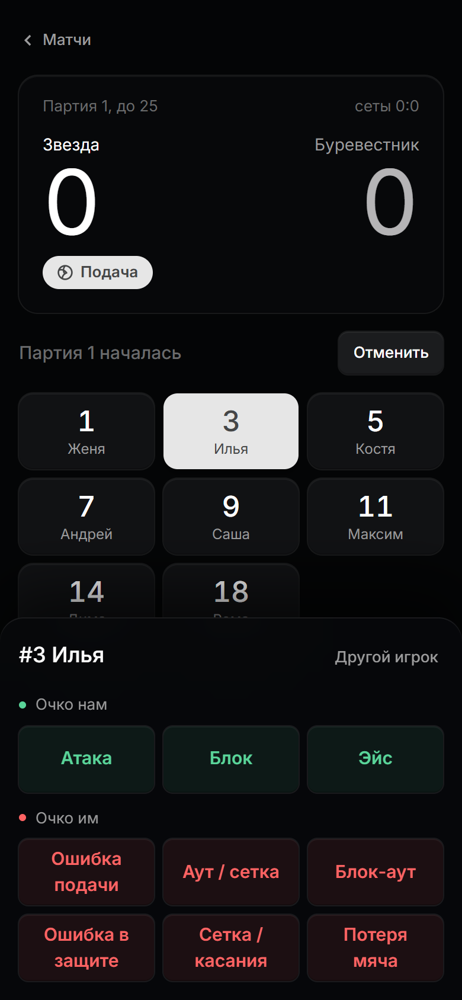</p>

1. Выбери матч и кто подаёт первым.
2. Розыгрыш закончился → нажми **игрока** → **чем**:
   - 🟢 очко нам: «Атака», «Блок», «Эйс»;
   - 🔴 очко им: «Ошибка подачи», «Аут / сетка», «Блок-аут», «Ошибка приёма», «Ошибка в защите», «Сетка / касания», «Потеря мяча».
3. Без игрока: «Ошибка соперника» или «Соперник забил» — одно нажатие.
4. Счёт, подача и конец партии считаются сами. «Отменить» убирает последнее очко.

Кнопки зависят от подачи: «Эйс» и «Ошибка подачи» есть только на нашей подаче, «Ошибка приёма» — только на подаче соперника.

---

### 📊 Аналитика

<p align="center">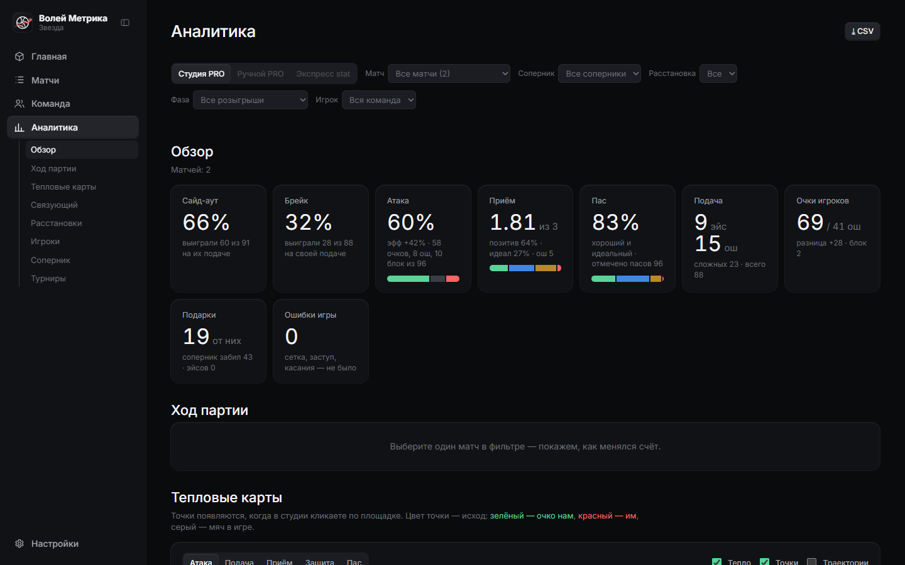</p>

Фильтры сверху: **режим, матч, соперник, турнир, расстановка, фаза, игрок**. Режим без данных не подсвечен. Если выбрать один матч, появятся вкладки партий. Под пунктом «Аналитика» в меню есть переходы к разделам. Кнопка **CSV** выгружает все касания по фильтрам.

| Раздел | Что показывает |
|---|---|
| **Обзор** | Сайд-аут, брейк, атака (очки % и эффективность `(очки − ошибки − блоки) / атаки`), приём (рейтинг 0–3, позитив), пас, подача, подарки соперника |
| **Ход партии** | Разница в счёте после каждого розыгрыша, серии, тайм-ауты. Нужен выбранный матч |
| **Тепловые карты** | Атака, подача, приём, защита, пас. Только для Студии PRO: цвет точки — исход, по зонам — доля и процент успеха |
| **Связующий** | Распределение по направлениям и расстановкам, выбор после приёма `++` / `+` / `−`, концовка партии, нападающие, темп, качество паса |
| **Расстановки** | Сайд-аут, брейк, очки, атака и приём в каждой из Р1–Р6. Слабая и сильная подсвечены |
| **Игроки** | Таблица с сортировкой, «± на площадке», связки «связующий → нападающий», матчи |
| **Соперник** | Их атаки «откуда → куда» и таблица по номерам игроков, если включён скаутинг |
| **Турниры** | Как меняются главные показатели от турнира к турниру |

<p align="center">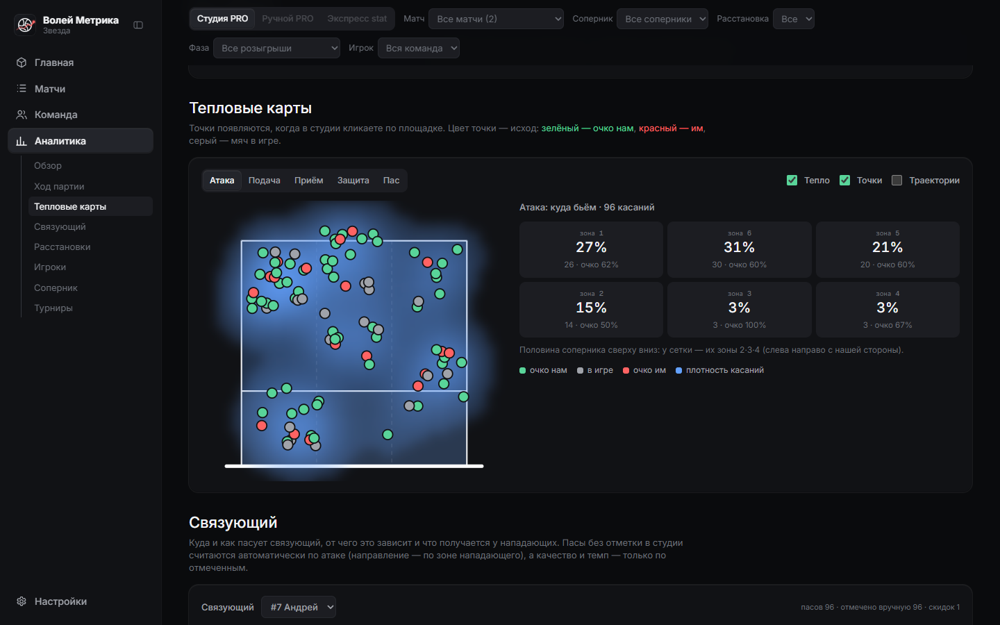</p>

<p align="center">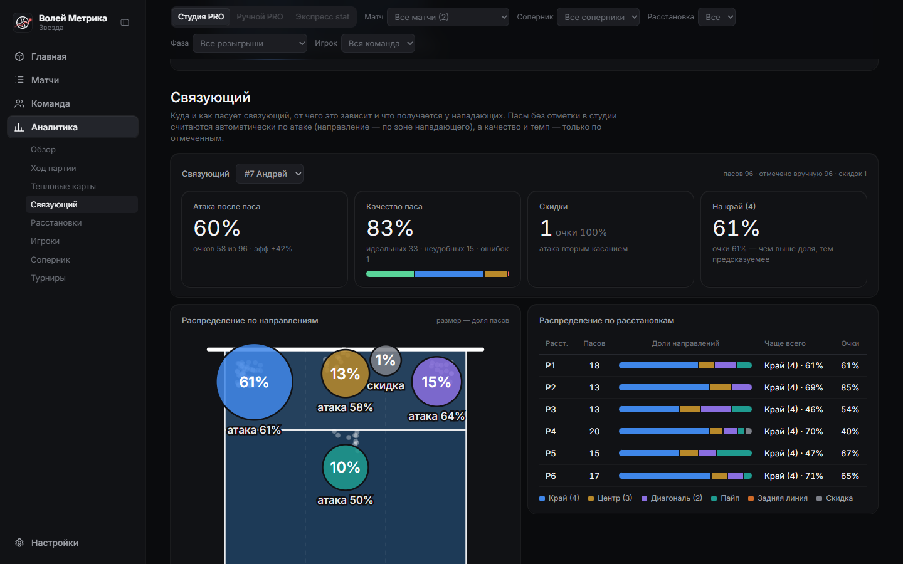</p>

<p align="center">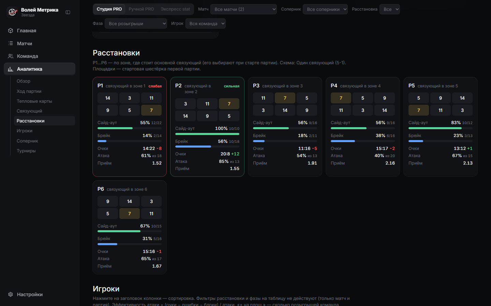</p>

В режиме Экспресс stat разделы другие: Итог, Подача и приём, Откуда наши очки, Как отдали очки, Лидеры, Таблица игроков и другие. Кнопка **«Настроить блоки»** выбирает, что показывать и в каком порядке.

**Отчёт игрока.** Клик по имени в таблице игроков открывает его страницу: очки и ошибки, атака, приём, подача, блок, карты, динамика и лучшие моменты. Кнопка **«⎙ PDF / печать»** сохраняет отчёт, чтобы отправить игроку.

---

### 👥 Команда и расстановки

<p align="center">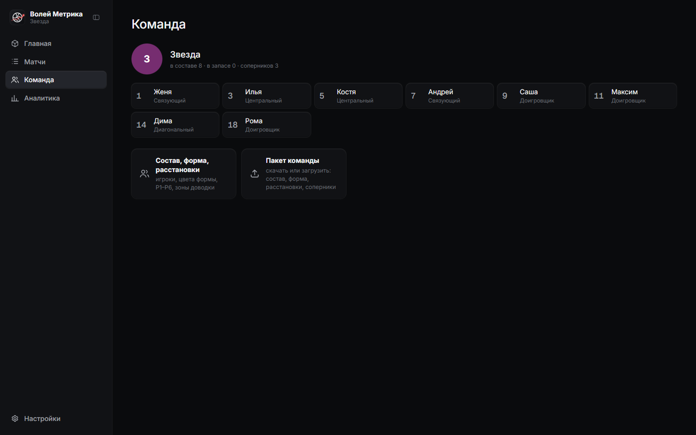</p>

**Настройки → Команда** (или раздел «Команда» в меню) собирает всё, что не зависит от конкретного матча:

- **Игроки, форма, соперники** — номер, имя, роль и статус. «В составе» попадает в новые матчи, «в запасе» пока не играет, но статистика в старых матчах остаётся. Имена можно менять когда угодно, старые матчи покажут новые.
- **Форма** — цвет майки, шортов и цифр, отдельная майка связующего и либеро. Обводка цифр подбирается сама.
- **Эмблемы** своей команды и соперников.

**Роли:** СВ — связующий, ДИ — диагональный, ДО — доигровщик, ЦБ — центральный, ЛБ — либеро. Команда может играть и без либеро.

#### Расстановки

<p align="center">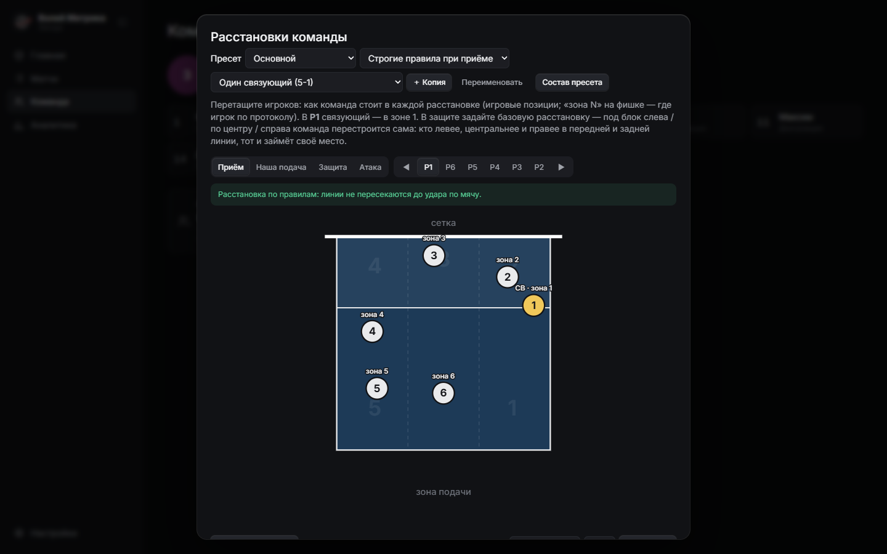</p>

Кнопка с людьми над площадкой или **Настройки → Команда → Расстановки**. Вид сверху на нашу половину: для каждой из **Р1–Р6** и каждой ситуации перетащи игроков туда, где они стоят у вас.

- Расстановки идут в порядке игры: **Р1 → Р6 → Р5 → Р4 → Р3 → Р2**.
- Расстановки **связаны**: настроил Р1 и перешёл к следующей — игроки сами сдвинутся на переход, останется подправить. Настроенные вкладки отмечены зелёным.
- В **защите** задаётся базовая расстановка, а под блок слева, по центру и справа команда перестраивается сама.
- **«Передняя по ролям»** ставит переднюю линию по амплуа: ДО слева, ЦБ в центре, СВ или ДИ справа.
- **«Скопировать из»** берёт позиции из другой ситуации или расстановки.
- **«Протокольная»** ставит всех ровно в свои зоны.

**Пресеты** — именованные наборы: схема (5-1, 4-2, 6-2, гибрид), стартовый состав и все расстановки. Например, «Гибрид» на один турнир и «4-2» на другой. Матч использует свой пресет, а новые матчи берут последний сохранённый.

**Состав пресета:** для каждой зоны выбираешь игрока и связующего. Достаточно задать Р1 так, как вы стоите в игре, остальные переходы считаются по кругу. Потом в окне старта партии хватит выбрать Р1–Р6 и кто подаёт первым.

**Правила расстановки.** Для приёма редактор проверяет правила: линии 4·3·2 и 5·6·1, каждый передний ближе к сетке, чем стоящий за ним задний. Нарушители подсвечиваются красным с пояснением. Для гибридов и упрощённых турниров в пресете есть режим «Свободно». На своей подаче команда стоит свободно.

**Схема** только подсказывает, кто пасует, когда пас не отмечен явно. Жёстких правил нет: принимает и пасует тот, кого ты выбрал. **Р1…Р6** считаются по зоне основного связующего, как в DataVolley и VolleyStation: Р1 значит «связующий в зоне 1».

#### Зоны доводки

Кнопка с меткой над площадкой или **Настройки → Команда → Зоны доводки**. Вид сверху, клетка 0,5 м: кистью закрашиваешь, где «++», «+» и «−». Зоны могут быть любой формы, <kbd>Shift</kbd> + протянуть заливает прямоугольник. Настройка сразу работает во всех матчах.

---

### ⚙️ Настройки

Открываются окном поверх текущего экрана, с главной и из студии:

| Раздел | Что внутри |
|---|---|
| **Общие** | Режим подсказок, обучение, горячие клавиши |
| **Плеер** | Пауза при вводе, скорость и петля синхронизации, шаг перемотки |
| **3D-площадка** | Детализация игроков, подписи над игроками, вид при запуске, сетка зон |
| **Команда** | Игроки, форма, соперники, расстановки, зоны доводки |
| **Пульт** | QR-код и адрес для телефона |
| **Данные** | Экспорт и импорт, резервные копии, корзина |

---

<a id="remote"></a>

## 📱 Пульт и сеть

Телефон — только пульт. Он записывает Экспресс stat на компьютер, а смотреть статистику можно только на ноутбуке. Создавать матчи и менять настройки с телефона нельзя.

**Подключение:** на компьютере **Настройки → Пульт**, наведи камеру телефона на QR-код, выбери матч. Телефон и компьютер должны быть в одной сети.

**Иконка на телефоне:** в браузере «Поделиться → На экран «Домой»» (iPhone) или «Добавить на главный экран» (Android). Страница всё равно загружается с ноутбука, поэтому без него пульт не откроется.

### На турнире без Wi-Fi

1. На телефоне включи **точку доступа**. Мобильный интернет не нужен.
2. Подключи к ней ноутбук и запусти `start.bat`.
3. Второй телефон (статист) подключается к той же точке как к обычному Wi-Fi и сканирует QR-код.
4. VPN на ноутбуке выключи.

> [!WARNING]
> Проверь заранее: некоторые Android-телефоны в режиме точки доступа не дают устройствам видеть друг друга.
> Если второй телефон не открывает страницу, раздавай с другого телефона.

### Если пропала связь

Пульт не теряет нажатия. Если Wi-Fi или раздача отвалились, очки сразу считаются на экране телефона и копятся в очереди, которая переживает даже обновление страницы.
Вверху появится плашка «Нет связи с ноутбуком · в очереди N». Когда связь вернётся, всё отправится само по порядку, и повторная отправка не задвоит события.

---

<a id="keys"></a>

## ⌨️ Горячие клавиши

Раскладка не важна. В полях ввода клавиши не срабатывают.

<details open>
<summary><b>Студия PRO</b> (полный список — кнопка ⌨ или <kbd>?</kbd>)</summary>

<br>

| Клавиша | Действие |
|---|---|
| <kbd>Пробел</kbd> | пуск / пауза |
| <kbd>←</kbd> <kbd>→</kbd> | назад / вперёд 5 с, с <kbd>Shift</kbd> — 15 с |
| <kbd>,</kbd> <kbd>.</kbd> | кадр назад / вперёд |
| <kbd>[</kbd> <kbd>]</kbd> | скорость видео |
| <kbd>L</kbd> | синхронизация с видео |
| <kbd>Tab</kbd> | быстро к следующей подаче |
| <kbd>PgUp</kbd> <kbd>PgDn</kbd> | предыдущий / следующий розыгрыш |
| <kbd>End</kbd> | к последней точке ввода |
| <kbd>V</kbd> | раскладка: видео / обе / площадка |
| <kbd>1</kbd>…<kbd>6</kbd> | игрок по номеру зоны |
| <kbd>A</kbd> <kbd>S</kbd> <kbd>D</kbd> <kbd>F</kbd> <kbd>G</kbd> <kbd>H</kbd> | группа: подача, приём, пас, атака, защита/блок, ошибка |
| <kbd>Q</kbd> <kbd>W</kbd> <kbd>E</kbd> <kbd>R</kbd> <kbd>T</kbd> <kbd>Y</kbd> | действие в группе |
| <kbd>+</kbd> <kbd>−</kbd> | ошибка соперника / соперник забил |
| <kbd>Z</kbd> | темп паса по кругу |
| <kbd>X</kbd> | мяч упал |
| <kbd>N</kbd> | атака в сетку |
| <kbd>⌫</kbd> | шаг назад |
| <kbd>Esc</kbd> | отменить незаконченный шаг |
| <kbd>Enter</kbd> | подтвердить подсвеченного игрока |
| <kbd>Ctrl</kbd>+<kbd>Z</kbd> | отменить последнее |
| <kbd>Ctrl</kbd>+<kbd>,</kbd> | настройки |
| <kbd>Ctrl</kbd>+<kbd>O</kbd> | на главную |

</details>

<details>
<summary><b>Экспресс stat с клавиатуры ноутбука</b></summary>

<br>

| Клавиша | Действие |
|---|---|
| <kbd>1</kbd>…<kbd>9</kbd>, <kbd>0</kbd> | выбрать игрока по порядку на экране |
| <kbd>Q</kbd> <kbd>W</kbd> <kbd>E</kbd> | атака, блок, эйс — очко нам |
| <kbd>A</kbd> <kbd>S</kbd> <kbd>D</kbd> <kbd>F</kbd> <kbd>G</kbd> <kbd>H</kbd> <kbd>J</kbd> | ошибка подачи, аут/сетка, блок-аут, ошибка приёма, ошибка в защите, сетка/касания, потеря мяча — очко им |
| <kbd>+</kbd> <kbd>−</kbd> | ошибка соперника / соперник забил |
| <kbd>Esc</kbd> | снять выбор игрока |
| <kbd>Backspace</kbd> | отменить последнее очко |
| <kbd>Enter</kbd> | следующая партия в окне конца партии |
| <kbd>1</kbd> <kbd>2</kbd> | кто подаёт первым: мы / соперник |

</details>

---

<a id="transfer"></a>

## 💾 Перенос данных и резервные копии

<p align="center">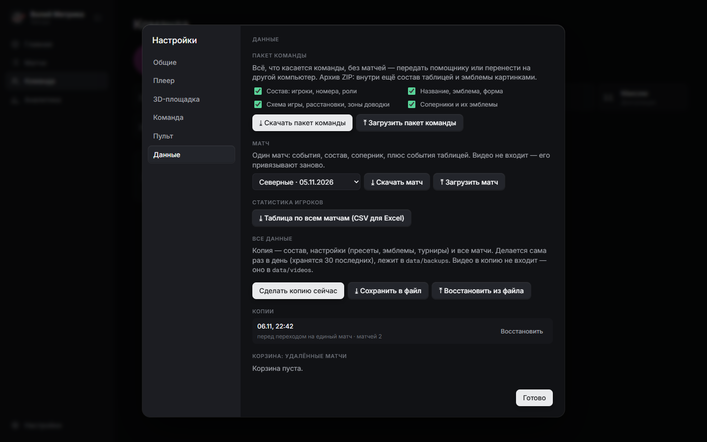</p>

Всё находится в **Настройки → Данные**:

| Что нужно | Кнопка | Что получится |
|---|---|---|
| **Передать команду без матчей** | «Скачать пакет команды» | ZIP: состав, название, эмблемы, форма, схема, расстановки, зоны доводки, соперники. Можно отметить только нужные части |
| **Передать один матч** | «Скачать матч» | ZIP: события, состав, соперник и таблица событий |
| **Передать всё сразу** | «Сохранить в файл» | один `.json`: состав, настройки с турнирами и все матчи |
| **Открыть статистику в Excel** | «Таблица по всем матчам» | CSV по детальным режимам |

> [!NOTE]
> **Видео ни в один файл не входит**, потому что оно большое. На другом компьютере его привязывают заново. Если нужно перенести видео со всеми привязками, скопируй папку `data/` целиком и положи рядом со `start.bat`.

### Как загрузить данные на другом компьютере

| Что прислали | Кнопка | Что произойдёт |
|---|---|---|
| Пакет команды | «Загрузить пакет команды» | Покажет, что внутри, и даст выбрать части. Игроки и соперники добавятся или обновятся, никто не удалится |
| Файл матча | «Загрузить матч» | Матч добавится. Новые соперники и игроки появятся сами, игроки попадут «в запас» |
| Файл `.json` | «Восстановить из файла» | **Заменит** состав, настройки и матчи содержимым файла |

> [!WARNING]
> «Восстановить из файла» подходит для новой установки или полного отката. Текущие данные перед этим сохраняются отдельной копией, а лишние матчи уходят в корзину.

### Резервные копии

- Копия делается **сама раз в день**, пока работает сервер. Хранятся 30 последних, папка `data/backups`.
- «Сделать копию сейчас» — ручная копия, например перед турниром.
- «Восстановить» у любой копии в списке откатывает данные. Текущие сохраняются отдельной копией.
- **Корзина:** удалённые матчи возвращаются кнопкой «Вернуть».

### Обновление программы

Скачай новую версию и перенеси в её папку свою папку `data/`. Старые матчи программа при первом запуске переведёт в новый формат сама, предварительно сделав резервную копию.

---

## ✅ Чек-лист перед турниром

**Дома, с интернетом:**

- [ ] запусти `start.bat`, чтобы убедиться, что всё поставилось;
- [ ] проверь состав, роли и пресет расстановок;
- [ ] сделай копию: **Настройки → Данные → Сделать копию сейчас**.

**На площадке:**

- [ ] включи точку доступа и подключи к ней ноутбук;
- [ ] выключи VPN;
- [ ] запусти `start.bat`, не закрывай чёрное окно;
- [ ] создай матч на компьютере;
- [ ] открой пульт на телефоне по QR-коду и проверь одно нажатие;
- [ ] поставь ноутбук на зарядку и отключи спящий режим.

---

<a id="faq"></a>

## 🩺 Решение проблем

<details>
<summary><b>При запуске пишет «npm» или «node» не является командой</b></summary>

<br>

Не установлен Node.js. Поставь версию LTS с [nodejs.org](https://nodejs.org/), закрой окно и снова запусти `start.bat`.
</details>

<details>
<summary><b>Ошибка <code>does not provide an export named 'crc32'</code></b></summary>

<br>

Node.js слишком старый. Нужен 20.15+ или 22.2+. Установи актуальную версию LTS с [nodejs.org](https://nodejs.org/).
</details>

<details>
<summary><b>Ошибка <code>EADDRINUSE</code> или браузер показывает другое окно</b></summary>

<br>

Порт 4200 уже занят: скорее всего, программа запущена во втором окне. Закрой лишнее чёрное окно, например от `demo.bat`, и запусти снова.
</details>

<details>
<summary><b>Телефон не подключается к пульту</b></summary>

<br>

1. Телефон и компьютер должны быть в одной сети.
2. Выключи VPN на ноутбуке.
3. Проверь брандмауэр Windows: Node.js должен иметь доступ к сети.
4. Если в настройках несколько адресов, попробуй тот, что начинается с `192.168`.
5. На Android-раздаче устройства могут не видеть друг друга: попробуй другой телефон.
</details>

<details>
<summary><b>Видео не открывается или долго готовится</b></summary>

<br>

Смотри прогресс в панели «Видео»: H.265 и другие тяжёлые форматы перекодируются, это может занять время. Если FFmpeg не установился, запусти в папке программы `npm install` при включённом интернете.
</details>

<details>
<summary><b>3D-площадка тормозит</b></summary>

<br>

**Настройки → 3D-площадка → Детализация игроков → Простые** или кнопка HD над площадкой. Проверь, что в браузере включено аппаратное ускорение.
</details>

<details>
<summary><b>В Студии нет данных с пульта</b></summary>

<br>

Так и задумано: режимы независимы. Переключи режим вверху раздела «Аналитика».
</details>

<details>
<summary><b>Случайно удалил матч</b></summary>

<br>

**Настройки → Данные → Корзина → Вернуть**. Файлы лежат в `data/trash/`.
</details>

<details>
<summary><b>После обновления пропали матчи</b></summary>

<br>

Скорее всего, новая версия лежит в другой папке. Перенеси туда папку `data/` из старой версии.
</details>

---

## 🛠 Для разработчиков

**Стек:** Node.js без фреймворка, обычные ES-модули в браузере, Three.js, FFmpeg. Сборка не нужна, готовый CSS лежит в репозитории.

```bash
npm install
```

```bash
npm start
```

```bash
npm test
```

| Команда | Что делает |
|---|---|
| `npm start` | сервер на `http://localhost:4200` |
| `npm test` | тесты движка, геометрии, переноса данных и сервера. Один тест пропускается, если нет `python3` |
| `npm run demo` | создать демо-данные в `demo-data/` |
| `npm run start:demo` | запустить сервер на демо-данных |
| `npm run build:css` | пересобрать `public/app.css` из `src/app.css` (Tailwind v4) |

Папка данных задаётся через `--data <папка>` или `DATA_DIR`, порт — через `PORT`.

```text
volleyball-metrics/
├─ server.js            HTTP-сервер и API: матчи, события, видео, копии
├─ transfer.js          экспорт и импорт: пакет команды, матч, CSV
├─ media.js             FFmpeg: проверка, конвертация, нарезки
├─ zip.js               ZIP без сторонних библиотек
├─ public/
│  ├─ index.html        оболочка: home.js, match-card.js, analytics.js, settings-ui.js
│  ├─ modes.js          режимы статистики и перенос старых матчей
│  ├─ engine.js         движок детальных режимов: счёт, подача, расстановки
│  ├─ quick-engine.js   движок Экспресс stat
│  ├─ studio.html       студия: studio/studio.js, court3d.js, figure3d.js, motion.js
│  ├─ detailed.html     Ручной PRO
│  ├─ quick.html        Экспресс stat и пульт, offline.js — очередь без связи
│  ├─ stats.js          аналитика детальных режимов
│  ├─ quick-stats.js    аналитика Экспресс stat
│  └─ vendor/three/     Three.js, чтобы 3D работало без интернета
├─ scripts/demo.js      генератор демо-данных
├─ src/app.css          исходник стилей пульта
└─ test/                тесты node --test
```

<details>
<summary><b>Почему так, а не иначе</b></summary>

<br>

- **Локальный сервер вместо облака:** на турнире может не быть интернета, а видео весит гигабайты.
- **Файлы JSON вместо базы:** данные легко посмотреть, скопировать и восстановить. Запись идёт через временный файл и очередь, поэтому файл не портится при сбое и быстрых нажатиях.
- **События вместо готовых цифр:** счёт, подача и статистика каждый раз пересчитываются из списка событий, поэтому правка задним числом всегда корректна.
- **Режимы не суммируются:** они собирают разную по глубине статистику одного матча.
</details>

---

## 📜 Сторонние компоненты

- [Three.js](https://threejs.org/) — 3D-площадка;
- [FFmpeg](https://ffmpeg.org/) через [ffmpeg-static](https://github.com/eugeneware/ffmpeg-static) — обработка видео;
- [qrcode](https://github.com/soldair/node-qrcode) — QR-код пульта;
- [Tailwind CSS](https://tailwindcss.com/) — стили пульта;
- шрифты [Inter](https://rsms.me/inter/) и [Geist Mono](https://vercel.com/font).
